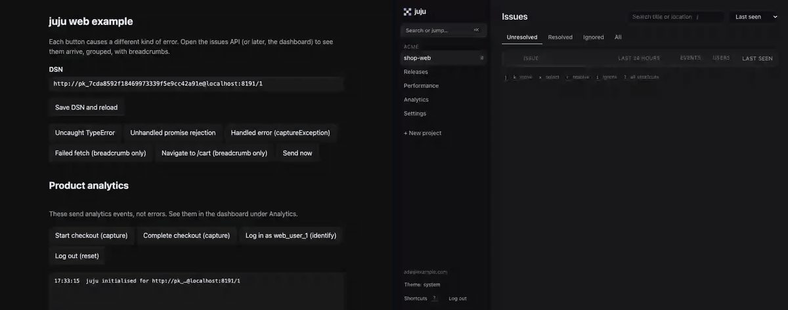

# juju

Error tracking and product analytics for Flutter, React Native and web apps, with a Go backend.
You can host it yourself on one small server.

[](docs/img/demo/demo.mp4)

On the left is the [example web app](examples/web) and on the right is the juju dashboard. Each button
throws a real error. A second later it appears in the dashboard as an issue, with no reload. The app
is minified, but the stack trace points to `checkout` in `app.js` line 44, because the build's source
map was uploaded. The **Breadcrumbs** tab lists the clicks and page changes that came before the
error, and `r` resolves the issue. [Watch the MP4](docs/img/demo/demo.mp4) for the full-size version.

## Try it with the example app

You need Go, Node and Python 3. Docker isn't needed.

```bash
make devdb                      # terminal 1: Postgres (keep it open)
make dashboard && make dev      # terminal 2: build the dashboard, then serve juju on :8080
make sdk example-web-build      # terminal 3: build the web SDK and a minified example app
make example-web                #             serve the example at http://127.0.0.1:5173/examples/web/
```

1. Open http://localhost:8080, create an account, then create a project. Copy its **DSN** and its
   **secret key**. The secret key is shown only once.
2. Upload the example's source map, so stack traces show `app.js` and not `app.min.js`:
   ```bash
   cd server && JUJU_URL=http://localhost:8080 JUJU_PROJECT=1 JUJU_SECRET_KEY=sk_... \
     go run ./cmd/juju upload ../examples/web/dist
   ```
3. Open `http://127.0.0.1:5173/examples/web/?dsn=<your DSN>`, keep the dashboard open next to it,
   and click the buttons.

There are example apps for the other SDKs too: [React Native](examples/react-native) and
[Flutter](examples/flutter).

## Add it to your app

```js
import * as juju from "@juju/web";   // or "@juju/react-native"
juju.init({ dsn: "https://pk_...@juju.example.com/1", release: "web@2.3.1" });

juju.capture("checkout_started", { plan: "pro" });   // product analytics, same DSN
juju.identify(user.id);
```

```dart
void main() => Juju.runZoned(() async {
      WidgetsFlutterBinding.ensureInitialized();
      await Juju.init(JujuOptions(dsn: 'https://pk_...@juju.example.com/1', release: 'shop@1.4.0+12'));
      runApp(const App());
    });
```

Each project in the dashboard shows its DSN and the setup code for each SDK. The [SDK guide](guides/sdks.md) covers all
the options.

## What you get

- **Issues**: errors are grouped by type and stack, so one bug is one issue. If a resolved
  issue comes back in a newer release, it's marked as a regression.
- **Readable stack traces** from minified JavaScript, React Native bundles and Flutter's split
  debug info, once you upload the debug files.
- **Product analytics**: trends, funnels and retention, stored in ClickHouse.
- **Alerts** to Slack or email when a new issue appears or an old one regresses.
- **Live dashboard**: open pages update by themselves, and you can do everything from the
  keyboard (`⌘K`, `j`/`k`, `r`).
- **Nothing gets lost**: once the server answers `202`, the event is in a durable queue, even if
  the server or Postgres goes down a moment later.
- **Privacy by default**: emails, tokens and passwords are scrubbed out at ingest, before anything
  is written.

## Guides

| | |
|---|---|
| [Running and hosting](guides/self-hosting.md) | local setup, the dashboard, teams and invites, super admin, deploying to a VPS |
| [SDKs](guides/sdks.md) | web, React Native and Flutter, product analytics, symbolication |
| [Scale, limits and privacy](guides/scale.md) | delivery guarantees, rate limits, retention, PII scrubbing, running in separate processes |
| [Working on juju](guides/development.md) | tests and a map of the code, re-recording the demo video |
| [Roadmap](https://francisije.github.io/juju/) | what's done and what's next ([source](docs/_src/roadmap.html), run `make docs` after editing it) |

Security model and how to report a vulnerability: [SECURITY.md](SECURITY.md).

## License

juju is in two parts, under two licenses:

- **The SDKs (`sdks/`) and examples (`examples/`)** are [MIT](sdks/LICENSE). They go inside your
  app, so you can ship, change and publish them without restriction.
- **Everything else**, the server and the dashboard, is under the
  [Functional Source License (FSL-1.1-ALv2)](LICENSE.md). You may read, run, change and self-host it
  for your own organization, but not offer it to others as a competing commercial service. Each
  version becomes Apache-2.0 two years after its release.
